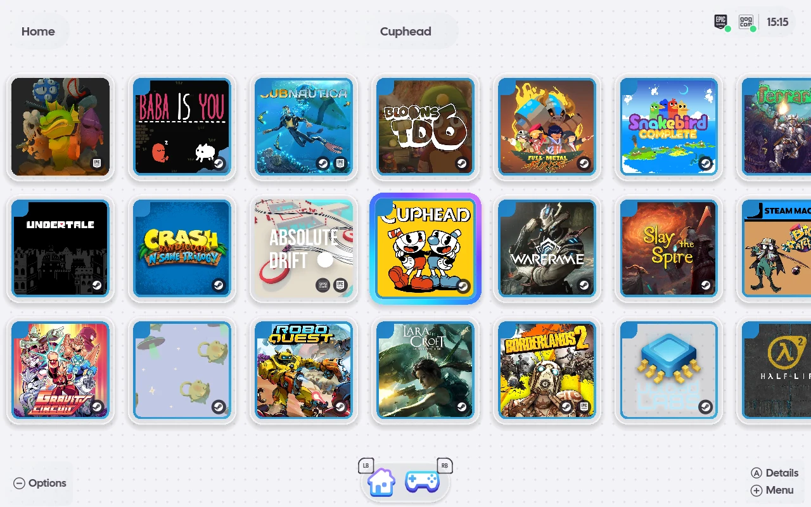
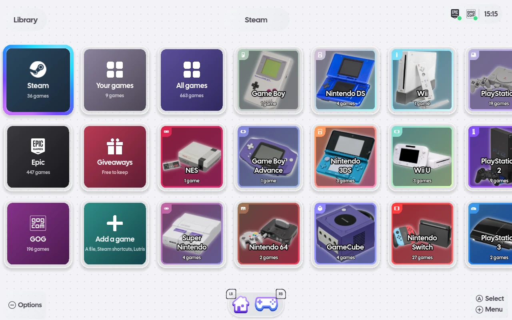
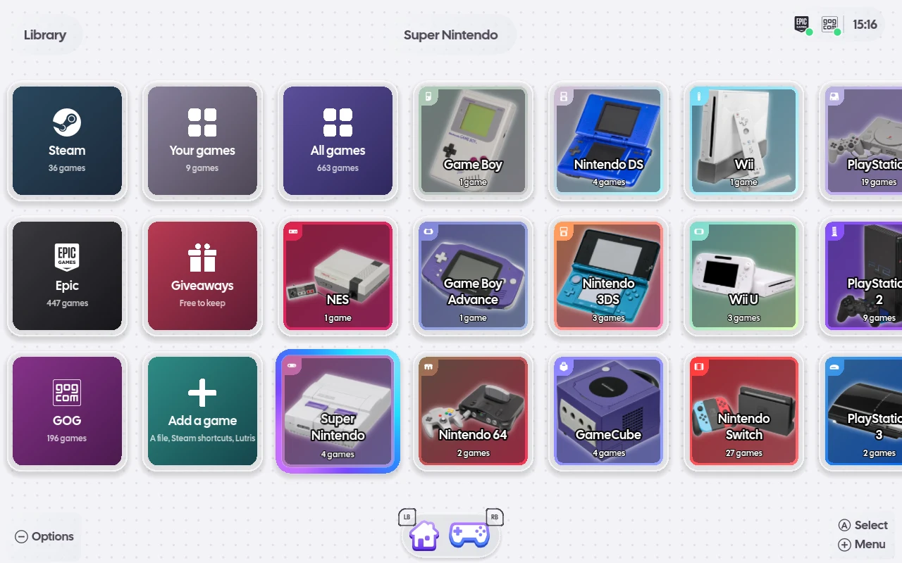
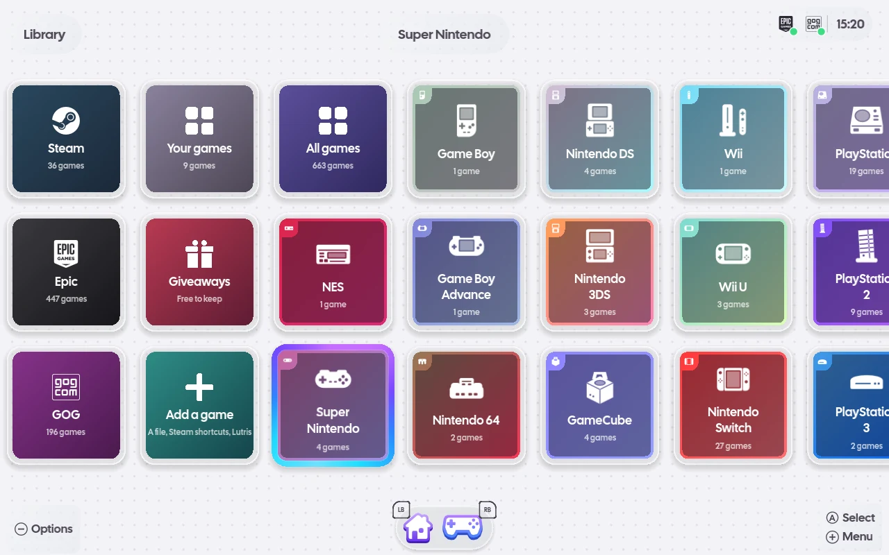
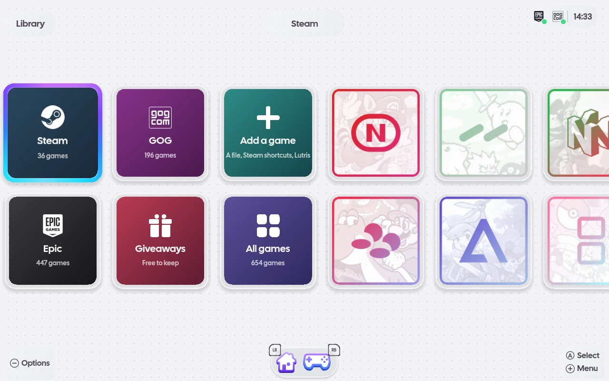
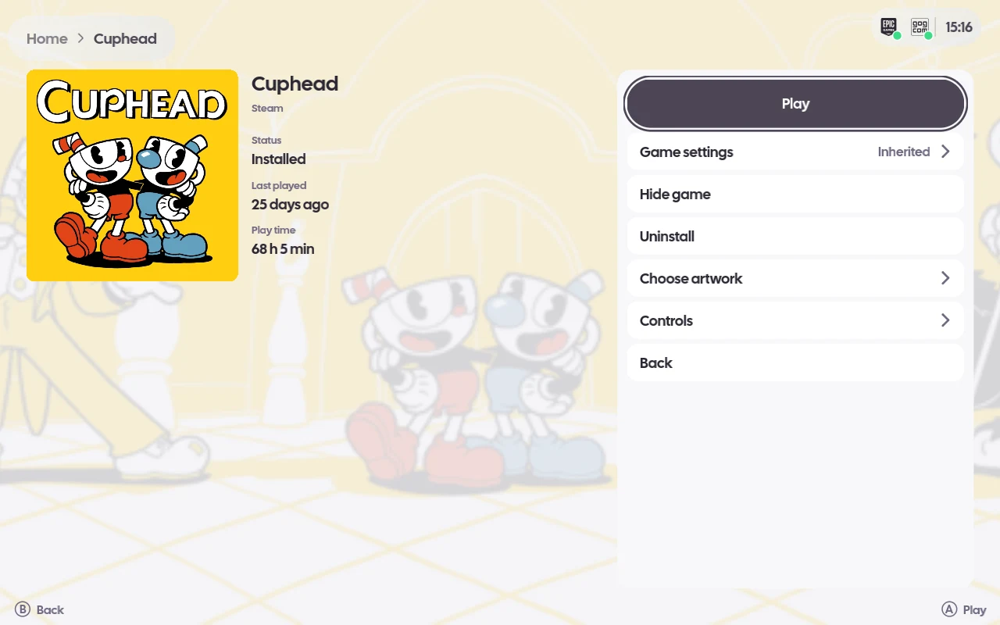
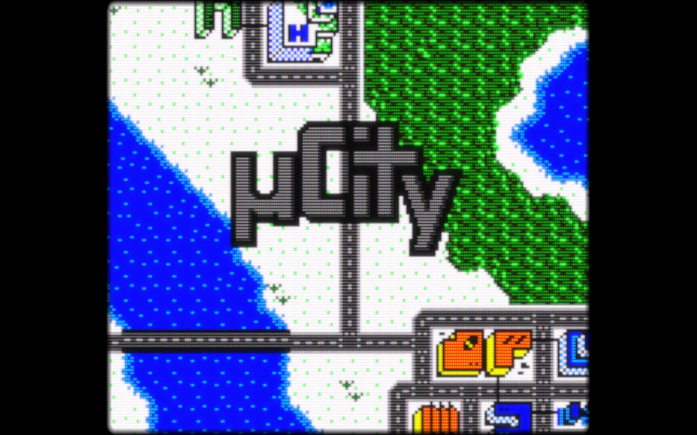
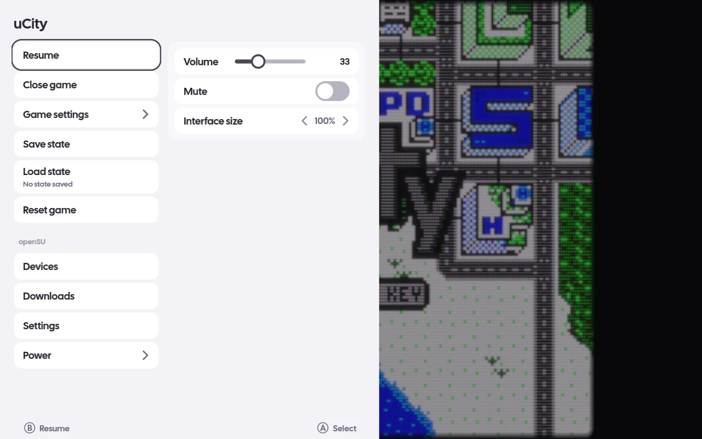
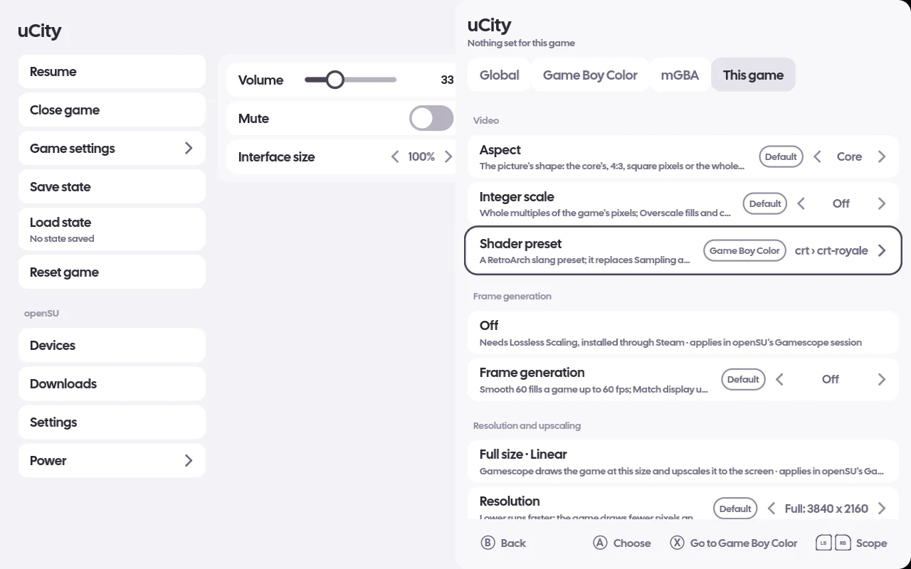

# openSU

A gamepad-first shell for your whole game library: Steam, Epic, GOG and emulator ROMs in one grid,
each launched into the runtime that already owns it. It is not an emulator and ships no games;
ROMs play on its built-in libretro runner or the standalone emulators you have.

## Features

- **Linux** (released): everything below, plus openSU's own Gamescope, nested on the desktop or as
  the login session, with per-game resolution, FSR and frame generation; Steam in Normal, Managed or
  Isolated mode; Windows store games under Wine or GE-Proton; button mappings for any game through
  virtual pads; Bluetooth, brightness and power from the Guide menu.
- **Windows** (released): Home, Library, search and details; ROMs on the built-in libretro cores
  with shader presets, setting layers and save states; standalone emulators; your desktop Steam;
  Epic and GOG native builds; Lua plugins.
- **Android** (released): the same shell with touch; ROMs from folders you pick, on the built-in
  cores with on-screen controls; installed emulator apps started with the game.
- **macOS** (coming): an Apple silicon app with the Windows feature set and stores' Mac builds.

Everything but the ROM library and the built-in runner is opt-in: Steam, Epic, GOG, standalone
emulators and plugins stay off until you turn them on. The full table is in
[docs/guide/install.md](docs/guide/install.md#what-each-platform-gets).

## Showcase

**Home and Library.** Installed games from every store on Home, plus any game or console you add;
stores, giveaways and one tile per console in Library.

| | |
| --- | --- |
|  |  |

**Console art themes.** Photos of the hardware (the default), openSU's own drawings, or iiSU's art
from a copy of iiSU you place yourself.

| Photos | Drawings | iiSU |
| --- | --- | --- |
|  |  |  |

**SteamGridDB covers.** Connect SteamGridDB and a cover Home's square tiles would crop is swapped for
SteamGridDB's square one; Choose artwork picks any other.

**libretro cores and shaders.** ROMs run on built-in libretro cores (downloaded and CRC-checked from
libretro's buildbot) with RetroArch slang shader presets. Here the homebrew uCity on mGBA with
`crt-royale`:

**The Guide menu over a game.** Resume, close, save and load state, reset, and the game's settings,
without leaving the game.

**Layered settings.** Every per-game setting (video, shader, core options, emulator, frame
generation, resolution) lives at Global, console, core or game, and each row says which layer it
comes from. Here the shader preset is inherited from Game Boy Color:

The shots are of the maintainer's own library and of uCity (GPL-3.0, art CC BY-SA 4.0); game art
belongs to its owners. Credits: [docs/screenshots/CREDITS.md](docs/screenshots/CREDITS.md).

## Install

From [Releases](https://github.com/SomeoneIsWorking/opensu/releases/latest):

- **Linux**: `openSU-<version>-x86_64.AppImage` (x86_64, glibc 2.39 or newer); `chmod +x` and run it.
- **Windows**: `openSU-<version>-x86_64-setup.exe`, a per-user installer for Windows 10 or newer.
- **Android**: `openSU-<version>-android.apk`, Android 9 or newer, arm64 or x86_64.
- **macOS**: not released yet.

Checksums, signatures and requirements: [docs/guide/install.md](docs/guide/install.md).

## Guide

- [Installing](docs/guide/install.md): packages, requirements, where your files live
- [Stores](docs/guide/stores.md): integrations, Steam modes, GOG and Epic sign-in, downloads,
  updates, your own games, SteamGridDB, giveaways
- [ROMs and emulators](docs/guide/roms-and-emulators.md): ROM folders, standalone emulators and
  their downloads
- [The libretro runner](docs/guide/libretro.md): cores, arcade romsets, BIOS, shaders, setting
  layers, save states
- [Windows games, Wine and Proton](docs/guide/wine.md)
- [Gamescope and session mode](docs/guide/session.md): FSR, frame generation, the login session
- [Controls](docs/guide/controls.md): pad and keyboard, Guide chords, button mappings
- [Profiles](docs/guide/profiles.md): players with saves of their own on one openSU
- [Console art and sounds](docs/guide/console-art.md)
- [Lua plugins](docs/guide/plugins.md)
- [LAN](docs/guide/lan.md): other openSUs on your network, pairing, their games in your library
- [Command line, environment and control channel](docs/guide/environment.md)
- [Building from source](docs/guide/building.md)

For contributors: [project goals](docs/project-goals.md), [project state](docs/project-state.md)
and [what of iiSU's UI has been recovered](docs/re-frontier.md). The reverse-engineering notes UI
comments cite (`home-grid.md`, `motion.md`, ...) are in a private repository checked out at the
gitignored `docs/reference/`; they are not needed to build or run openSU.

## License

openSU is MIT-licensed (`LICENSE`). Its typeface, Cal Sans (`assets/CalSans-Regular.ttf`, iiSU's
default), is under the SIL Open Font License (`assets/CalSans-OFL.txt`). openSU is an independent
project, not affiliated with iiSU, and ships none of iiSU's code or assets; iiSU's art and sounds
are read only from a copy of iiSU's release you place yourself
([console-art.md](docs/guide/console-art.md#iisus-art-and-sounds)).
