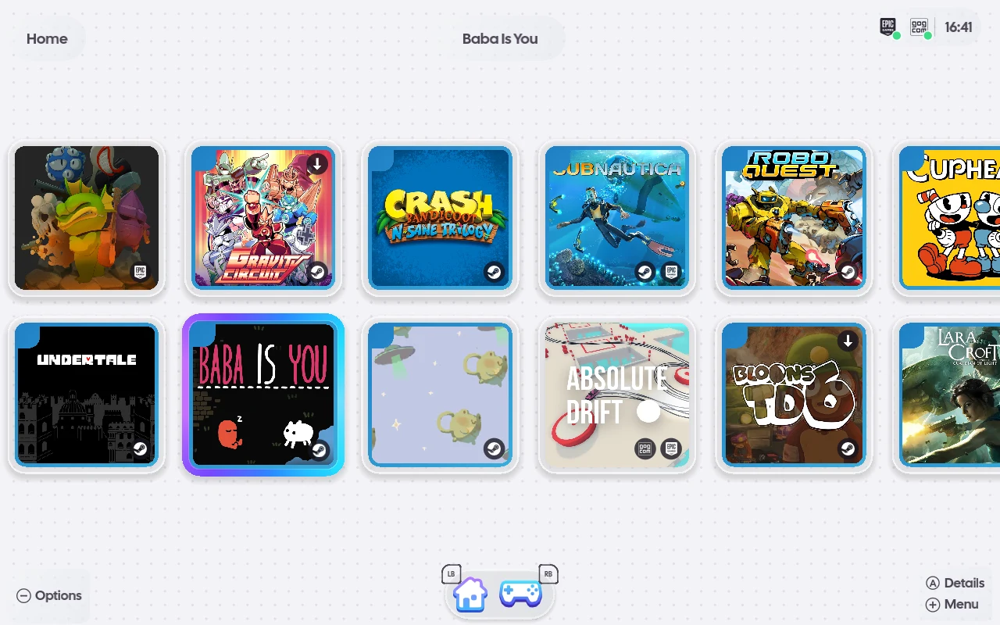
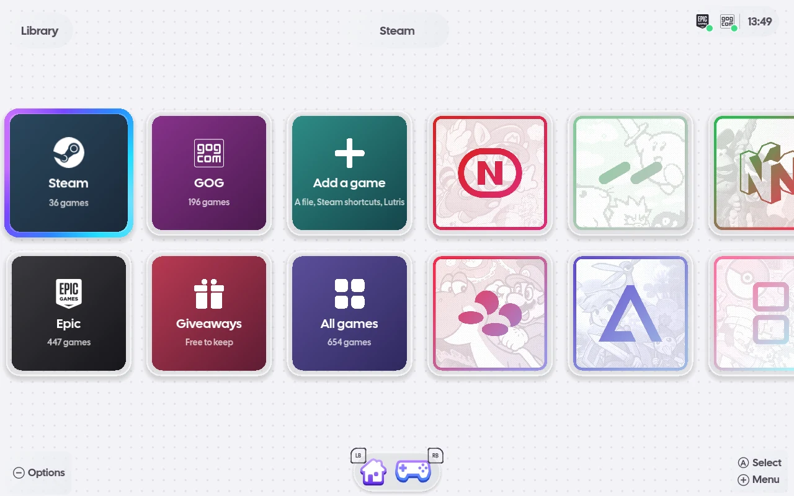
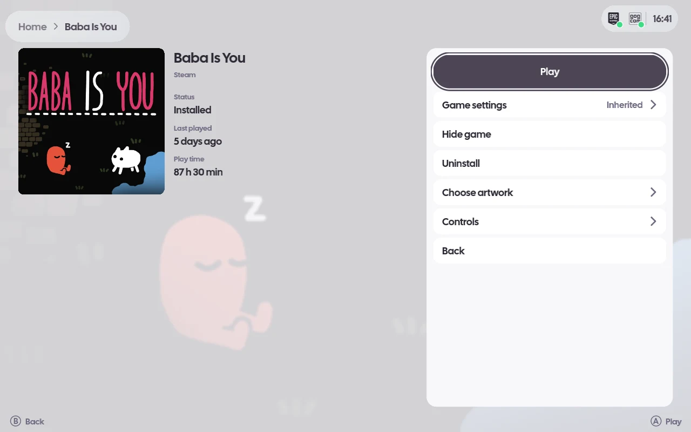
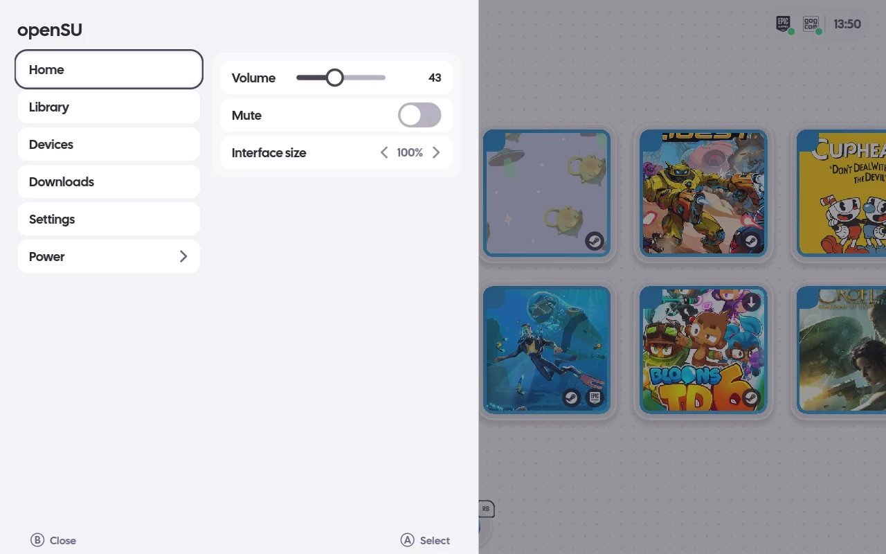
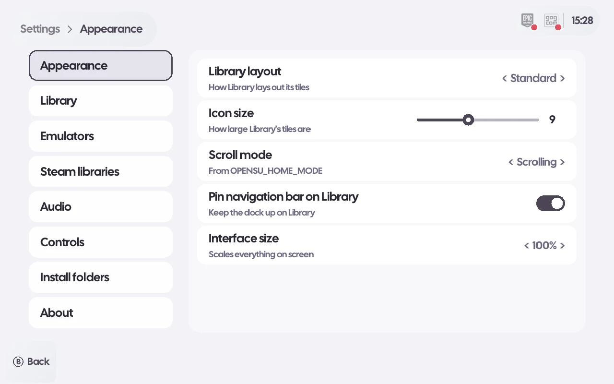
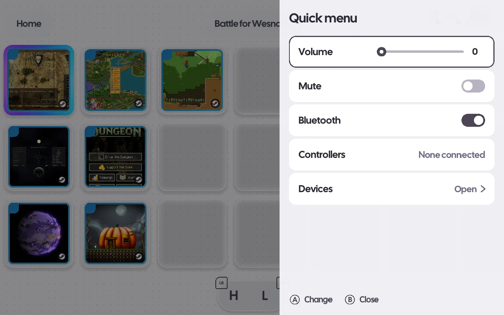

# openSU

A gamepad-first shell for a game library. It shows Steam, Epic, GOG and
emulator ROMs in one grid and launches each title into the runtime that already
owns it.

It is not an emulator and ships no games. Steam and Legendary keep doing their own
authentication, downloading and cloud sync; openSU reads what they have installed and
hands launches back to them. GOG is signed in by openSU itself (see Signing in to GOG and
Epic), its owned games are listed, and `gogdl` downloads them (see below).

Only the ROM library and the built-in libretro runner are on by default. Steam, Epic, GOG,
standalone emulators and Lua plugins are each turned on in Settings › Integrations; one that is
off starts nothing, reads nothing and shows nothing. The first run (and the first run after an
update, while the settings file has no choices) shows a chooser with all of them off.

Steam runs in one of two modes. Normal uses the player's own desktop Steam: openSU attaches to
the one running, or starts Steam on the desktop and leaves it running, and launches through
`steam -applaunch`. Managed (the only mode with `--session`) runs openSU's own Steam in the
background with `-cef-enable-debugging`, which opens Steam's DevTools on 127.0.0.1:8080; that is
how it reads download progress and starts installs through Steam's own installer, and openSU
ends it on exit. A desktop Steam serves those DevTools only when started with that flag.

Built with C++20, SDL3 and [gpu2d](https://github.com/SomeoneIsWorking/gpu2d), a 2D canvas on SDL3
GPU (Vulkan on Linux). The shell is drawn from geometry rather than
composed from images, so the layout is resolution independent and every size is
derived from the window, following iiSU's own layout rules.

## Screenshots

| | |
| --- | --- |
|  |  |
| Home: installed games from every store | Library: stores, all games and one tile per console |
|  |  |
| A game's details page | Guide menu |
|  |  |
| Settings | Quick menu |

The demo library is freely licensed games; art sources and licences are in
[docs/screenshots/CREDITS.md](docs/screenshots/CREDITS.md). Captured with
`uv run --frozen python -m tools.screenshots`.

## Installing the AppImage

Each [release](https://github.com/SomeoneIsWorking/opensu/releases) carries
`openSU-<version>-x86_64.AppImage`, its `.sha256`, a `.zsync` for AppImageUpdate and the sign-in
extension `opensu-signin.xpi`:

```sh
sha256sum -c openSU-<version>-x86_64.AppImage.sha256
chmod +x openSU-<version>-x86_64.AppImage
./openSU-<version>-x86_64.AppImage
```

The AppImage holds openSU, its assets, the sign-in extension (`usr/share/opensu/opensu-signin.xpi`)
and the pinned Gamescope fork. It is signed with the key in
`packaging/appimage/signing-key.asc` (fingerprint `0604 E249 E180 039C 3BA2 FEF3 419F 535F 9867 0291`);
`./openSU-<version>-x86_64.AppImage --appimage-signature` prints the signature. Settings, data and
cache stay in `$XDG_CONFIG_HOME/opensu`, `$XDG_DATA_HOME/opensu` and `$XDG_CACHE_HOME/opensu`
(`.config`, `.local/share` and `.cache` in the home folder by default), never inside the
AppImage. Session mode (Power › Install session mode) needs an openSU installed from source: the
AppImage's mount point changes on every run, so a login session entry cannot name it.

Requirements, which a desktop install of a current distribution already has:

- x86_64 Linux with glibc 2.39 or newer
- OpenGL and Vulkan drivers for the GPU (Mesa or the vendor's), and Xwayland
- FUSE 3 (`fusermount3`); libfuse2 is not needed, the runtime is the static type 2 one
- libcurl, libcrypto (OpenSSL 3), the PipeWire, ALSA and PulseAudio client libraries and a systemd
  user session

On Fedora: `sudo dnf install fuse3 libcurl openssl-libs pipewire-libs alsa-lib pulseaudio-libs mesa-vulkan-drivers
xorg-x11-server-Xwayland`. On Ubuntu: `sudo apt install fuse3 libcurl4t64 libssl3t64 libpipewire-0.3-0t64
libasound2t64 libpulse0 mesa-vulkan-drivers xwayland`.

Tested on Fedora 44 and Ubuntu 24.04 (clean containers with only the runtime libraries above: the
AppImage mounts, every bundled library resolves, the Gamescope binary loads and openSU renders a
frame; a Gamescope session itself is not run there); other
distributions with glibc 2.39 or newer should work but are untested. Linux only: a Windows build
(without Gamescope) is a possible future target, macOS is not planned.

`uv run --frozen python -m tools.appimage all` builds it in a podman container (Ubuntu 24.04, the
glibc floor) and runs the same checks; the AppImage lands in `build/appimage/out/`.

## Building

openSU needs checkouts of [Lucent](https://github.com/SomeoneIsWorking/lucent), its logger, and
[gpu2d](https://github.com/SomeoneIsWorking/gpu2d), its renderer, image codecs and text, and
[nanosvg](https://github.com/memononen/nanosvg) for its icons: the distribution's
package (`nanosvg-devel` on Fedora), else a checkout at `NANOSVG_ROOT`, by default
`$HOME/dev/nanosvg`. The launcher logos are from [Simple Icons](https://simpleicons.org)
(CC0). The window, keyboard, mouse and sound are SDL3's; gpu2d draws with SDL3 GPU and reads
faces and images through HarfBuzz, SDL3_ttf and SDL3_image (`SDL3-devel SDL3_ttf-devel
harfbuzz-devel SDL3_image-devel libpng-devel` on Fedora), and the UI sounds are Ogg Vorbis (`libvorbis-devel`). libcurl
(`libcurl-devel`) downloads missing artwork; libcrypto (`openssl-devel`) decrypts a Switch game's
own title and icon with the player's keys; zlib (`zlib-devel`) reads iiSU's starter pack, libwebp
(`libwebp-devel`) decodes its console cards, nlohmann/json (`json-devel`) reads and writes the
settings and libX11 and libXi (`libX11-devel libXi-devel`) read the in-game shortcut keys.
`opensu-retro`, the built-in libretro runner, also needs the Vulkan loader and glslc
(`vulkan-loader-devel glslc` on Fedora); its tests and the shell's draw on any Vulkan driver,
lavapipe (`mesa-vulkan-drivers`) included, and use the validation layers
(`vulkan-validation-layers`) when installed.

```sh
git clone https://github.com/SomeoneIsWorking/lucent.git
git clone https://github.com/SomeoneIsWorking/gpu2d.git
```

Or let `uv run --frozen python -m tools.check all` do it: it checks out Lucent and gpu2d at the
commits `tools/check/pins.py` pins into `build/check/deps`, then configures, builds,
lints (clang-format, clang-tidy, ruff) and tests openSU with Clang in `build/check`, as CI does
(`--gamescope native` when Gamescope's build dependencies are installed, `off` to skip the fork).

Then point openSU at both (`LUCENT_ROOT` defaults to `$HOME/repo/lucent`, `GPU2D_ROOT` to
`$HOME/repo/gpu2d`):

```sh
cmake -S . -B build/cmake -G Ninja -DCMAKE_CXX_COMPILER=clang++ \
      -DLUCENT_ROOT="$PWD/lucent" -DGPU2D_ROOT="$PWD/gpu2d"
cmake --build build/cmake
```

### Gamescope fork

The nested session (openSU started on a desktop) runs openSU's own pinned
[Gamescope fork](https://github.com/SomeoneIsWorking/gamescope) (branch `opensu`), built by
`cmake/Gamescope.cmake` from a fixed commit. It adds `--close-focused-window`, so Alt+F4 in KDE
closes the game instead of ending the session. The fork is built with meson and ninja inside a
rootless podman container, so the host needs no Gamescope build dependencies, only podman
(`sudo dnf install podman`) and the network once. The container image
(`packaging/gamescope-build/Containerfile`) is the host's own Fedora release plus
`dnf builddep gamescope`, clang, meson, ninja and glslang, tagged by the Containerfile's hash; the
first `cmake --build` pulls and builds it (a few GB of image, several minutes), clones the commit
and its submodules, and builds the fork. Afterwards nothing is rebuilt until the Containerfile
changes. Only Fedora hosts are supported; configure refuses elsewhere. The staged binary's
runtime libraries are checked on the host with `ldd`; `sudo dnf install gamescope` installs any
that are missing. To work on the rest of openSU without the fork, configure with
`-DOPENSU_BUILD_GAMESCOPE=OFF`; the
nested session then refuses to start and says so. `cmake --install` puts the binary at
`<prefix>/libexec/opensu/gamescope`, where an installed openSU looks; a build-tree openSU looks at
`<build>/libexec/opensu/gamescope`. There is no `PATH` lookup and no fallback to the distribution's
Gamescope.

## Running

```sh
./build/cmake/src/opensu                  # the shell
./build/cmake/src/opensu --render out.png # one frame to a file, no window shown
./build/cmake/src/opensu --hidden         # maintainer run: unmapped window, no pads, free control port
./build/cmake/src/opensu --session        # openSU is the login session, not an app on a desktop
```

### Login session

`--session` makes openSU the login session: from a display manager it starts the pinned Gamescope
top level on the seat (`--backend drm`, the monitor's own mode) with openSU in it, and there is no
desktop underneath. Closing openSU ends the session.

From the desktop, open the Guide menu, then Power. **Install session mode** explains what it is and
what it installs, and on Accept asks for your administrator password inside openSU (a masked field,
the on-screen keyboard or your keyboard; it goes to `sudo` on stdin and is never stored or logged).
It runs one `sudo` step that puts three things in place:

| File | Why |
| --- | --- |
| `/usr/local/share/wayland-sessions/opensu.desktop` | the session entry SDDM lists |
| `/usr/local/libexec/opensu-session-select` | a small root-owned script that sets which session the next login uses (`opensu` or `restore`) |
| `/etc/sudoers.d/zz-opensu-session-select` | lets your user run exactly that script with exactly those two arguments, without a password |

Afterwards Power shows **Switch to session mode** (press A twice): it selects openSU for the next
login and logs the Plasma session out, and SDDM logs in to openSU. In the session, Power then
**Switch to desktop** selects the previous session again and ends openSU. With SDDM autologin the
selector writes `/etc/sddm.conf.d/zz-opensu-session.conf` (`[Autologin] Session=`, which wins over
`kde_settings.conf`) and removes it on restore; without autologin it sets SDDM's last session in
`/var/lib/sddm/state.conf`. What was there before is kept in `/var/lib/opensu/previous-session`.
Switching to session mode ends the session with KDE's `org.kde.Shutdown.logout`, so it needs
Plasma; on another desktop the selection is undone and the refusal shown.

`cmake --install` also puts `install-session.sh` and `opensu-session-select` in
`<prefix>/libexec/opensu/`, and prints the same step for a terminal:

```sh
sudo sh ~/.local/libexec/opensu/install-session.sh
```

(for the `~/.local` prefix). Without the selector, Switch to desktop in a session entered through an
entry installed by hand still works: openSU leaves a note, ends its Gamescope and starts
`startplasma-wayland` in the session's place.

`--hidden` logs its control channel port; drive it with `POST /input` (buttons incl. `l2 r2 l3 r3`; `guide+a` holds buttons together; `guide 1500ms` holds them that long, up to 10000ms), `POST /key` (e.g. `ctrl+up`), `POST /text`, and read `GET /state` (adds `settingsOpen`, `folderPickerOpen`, `firstRunOpen`, `capturingShortcut`, `volumeShown`, `chordHint`, `mapping`, `volumePercent`, `volumeMuted`, `uiScale`, `artworkPending`). A hidden run only reads the system volume and never starts the Steam client (Steam shows as stopped); it also never sleeps, restarts, shuts down, scans, pairs, connects or forgets Bluetooth devices, and never writes the brightness.

Overrides, all optional:

| Variable | Meaning |
| --- | --- |
| `OPENSU_STEAM_ROOTS` | Colon-separated Steam install roots. Discovered when unset. |
| `OPENSU_ROM_ROOTS` | Colon-separated ROM roots, each holding one folder per system. Discovered when unset. |
| `OPENSU_EMULATORS` | Per-system command overriding the one found: `ps2=pcsx2-qt -batch {rom};gc=dolphin-emu -b -e {rom}`. |
| `OPENSU_WIDTH`, `OPENSU_HEIGHT` | Window size, default 1280x800. |
| `OPENSU_ASSETS` | Directory holding the typeface. Defaults to `share/opensu` beside the executable's directory. |
| `OPENSU_HOME_MODE` | `standard` (scrolling grid, default) or `wiisu` (paged grid). |
| `OPENSU_SECRET_STORE` | `file` keeps secrets (the SteamGridDB key) in an owner-only file under the config dir instead of the desktop keyring. |

The environment seeds defaults; the Settings screen (START, last row) saves the player's choices
(interface size, volume, shortcuts, install folders) in `settings.json`, and those win.

The build stages the assets beside the binary, so it runs from any directory.

## Installing from source

Configure with the prefix to install to, then install. The binary, its assets, its icon and a
desktop entry (`share/applications/opensu.desktop`, which shows openSU in the
application menu) go under the prefix:

```sh
cmake -S . -B build/cmake -G Ninja -DCMAKE_CXX_COMPILER=clang++ \
      -DLUCENT_ROOT="$PWD/lucent" -DGPU2D_ROOT="$PWD/gpu2d" \
      -DCMAKE_INSTALL_PREFIX="$HOME/.local"
cmake --build build/cmake
cmake --install build/cmake
```

For a desktop icon as well, copy the entry to the desktop and mark it executable:
`cp "$HOME/.local/share/applications/opensu.desktop" "$(xdg-user-dir DESKTOP)/" && chmod +x "$(xdg-user-dir DESKTOP)/opensu.desktop"`.

Controllers are read from evdev: any pad whose driver follows the kernel's gamepad
codes (xpad, xone, hid-playstation, hid-nintendo, ...) works, keyboards are never
taken for one, and a pad switched on while openSU runs is picked up.

ROMs live in a ROM root (a folder named `ROM`, `ROMs` or `roms` in the home folder, in
`~/Emulation`, or at the top of a mounted drive) with one folder per system (`PS2`, `GameCube`,
`Switch`, `PSX CHD`, ...). A system folder holds game files or game folders; in a folder, the
base game is started rather than its updates and DLC. Emulators are found on PATH, as AppImages
in `~/Applications`, `~/AppImages` or `~/.local/bin`, or as Flatpaks: Dolphin, Cemu, Eden,
Ryujinx, PCSX2, RPCS3, shadPS4, DuckStation, PPSSPP, melonDS, Azahar, mGBA, xemu and Xenia
Canary. A game whose system has no emulator still appears, and pressing play names the
emulator to install. A PS4 dump and a Switch game are titled and shown by their own files: a
Switch NSP or XCI is read with the keys Eden uses (`~/.local/share/eden/keys/prod.keys` and
`title.keys`), offline; the keys are only read, never copied, logged or sent.

Emulators that publish an official AppImage (Cemu, Eden, PCSX2, RPCS3, DuckStation, PPSSPP,
Azahar, mGBA, xemu) can be downloaded from a ROM's details page ("Download <emulator>") or from
Settings › Emulators, into `~/.local/share/opensu/emulators/<id>/`. A download is checked against
the release's published SHA-256 and refused on a mismatch; without one, only HTTPS from the
project's own host is accepted and the checksum seen is recorded. Settings › Emulators also
checks for updates (nothing updates by itself), removes openSU's AppImages and picks the
emulator for each system. openSU links no BIOS, keys or firmware. An AppImage needs FUSE
(`/dev/fuse`, `fusermount`); one built on the older runtime also needs libfuse2, and openSU
names the package to install when it is missing.

Settings › Steam libraries lists Steam's libraries with free space and games, adds one, sets
the default and removes an empty one; it is read-only while Steam is not running. Settings ›
Install folders shows the folder each store installs into and whether it is the store's own,
the default or an override.

## Signing in to GOG and Epic

Sign-in happens in your own browser, on the store's own page. openSU opens the page with
`xdg-open`, and a small browser extension hands the code the page ends on to openSU's control
channel and closes the tab. The build packs it as `~/.local/share/opensu/opensu-signin.xpi`
(for the `$HOME/.local` prefix); a release carries it beside the AppImage.

Zen does not require signed extensions, so it can be installed for good: close Zen, copy the
`.xpi` to `<profile>/extensions/opensu-signin@opensu.xpi` (the Flatpak's profiles are under
`~/.var/app/app.zen_browser.zen/.zen/`), and add to the profile's `user.js`:

```js
user_pref("xpinstall.signatures.required", false);
user_pref("extensions.autoDisableScopes", 14);  // enable add-ons placed in this profile
```

Firefox release builds enforce signing, so there it can only be loaded per session:
`about:debugging` → This Firefox → Load Temporary Add-on → the `.xpi` (Ctrl+L takes a typed
path). A Flatpak browser cannot load the bare `manifest.json`: its file picker hands over only the
chosen file, not the scripts beside it. The extension talks to port 7311, openSU's default `OPENSU_CONTROL_PORT`.

```sh
curl -X POST http://127.0.0.1:7311/signin/gog/start   # opens GOG's sign-in page
curl -X POST http://127.0.0.1:7311/signin/epic/start  # opens Epic's, through Legendary's login
```

`POST /signin/gog` and `POST /signin/epic` take the authorization code as the body; the
extension does that for you. Epic's code is given to `legendary auth --code`. GOG's token is
kept in `$XDG_DATA_HOME/opensu/gog-token.json` (default `~/.local/share/opensu`), readable by
you only.

## Installing GOG games

GOG downloads go through `gogdl`, Heroic's standalone GOG downloader (no Heroic launcher).
Install it once, without root, pinned to the revision openSU was written against:

```sh
uv tool install "git+https://github.com/Heroic-Games-Launcher/heroic-gogdl@ac1580aeb004dda75557c97be9cc3105d50eeecb"
```

It needs a C compiler, for its xdelta3 extension. A game with a Linux build is downloaded as
that build; otherwise the Windows build is downloaded and run under Wine. Games land in
`$XDG_DATA_HOME/opensu/gog-games/<id>/`.

## Windows games and Wine

Windows GOG and Epic games run under Wine in one shared prefix,
`$XDG_DATA_HOME/opensu/wine-prefix`. A game's details page has "Wine prefix": switch it to Own and
that game gets `$XDG_DATA_HOME/opensu/wine-prefixes/<store>-<id>` instead. Settings › Wine picks
the runner: the system `wine`, or a Proton build found in Steam's `compatibilitytools.d` or
`steamapps/common` (its bundled `wine`). Steam games keep the compatibility tool chosen in Steam.

## Downloads

Guide › Downloads lists every download openSU knows of: Steam's queue (its updates too), the Epic,
GOG or Steam install started from openSU, and an emulator or core download, each with its progress
and state. Steam's downloads can be paused and resumed (the whole queue, as in Steam), started
now, moved and removed; the others can be cancelled. Finished downloads stay listed until openSU
quits. A click on the Steam badge in the top bar while it shows a download's progress ring opens it
too.

## Uninstalling games

An installed Steam, Epic or GOG game's details page and tile menu (Select) have Uninstall. The
first press says what will go, and a second press removes it; moving to another button cancels.
Steam removes its own games through its own uninstaller; Epic games go through
`legendary uninstall`. A GOG game's folder is deleted only when it is inside the folder openSU gave
`gogdl` for it (`<install folder>/<id>/`); a game recorded anywhere else is only forgotten, its
files kept. Wine prefixes and ROMs are never deleted. An uninstall is refused while the game runs
or another install or uninstall is under way, and shows on the Downloads page while it runs.

## Updating games

When the library loads, openSU checks which installed Steam, Epic and GOG games have an update: a
small arrow on the tile marks them, and their details page and tile menu offer Update. Nothing
updates by itself, and launching a game with an update starts the installed version. Epic games
update through `legendary update`, GOG games through `gogdl update` in the folder they were
installed to, and a Steam game's update is put on Steam's own queue. An update is refused while the
game runs or another install, update or uninstall is under way, and shows on the Downloads page.

## Controls

| Input | Action |
| --- | --- |
| D-pad or left stick | Move focus |
| A (Enter, click) | Open a game's details page; Play, Install, change a ROM's emulator or Hide from there |
| Y | Details page |
| Select (Tab, Menu key, Shift+F10, right click) | Context menu of the focused tile |
| X | Refresh the library |
| LB / RB | Previous / next page (`wiisu` mode only) |
| Start | Back to the first tile |
| Guide (in a game) | Menu over the game: Resume or Close game; B or Guide resumes. The game gets no controller input while it is open |
| Guide + A | Quick menu, over a game too |
| Guide + Up / Down / Left | Volume up / down / mute |
| Hold Guide (or any chord's held button) | After half a second, a list of that button's chords, also over a game in session mode; it goes when you let go or play a chord |

Chords are set on Settings › Guide chords: Quick menu, the volume, Close game, Save state, Load
state, Reset game, Devices, Downloads and Home. Hold any button and press another to set one. A chord's buttons
never reach the game. The held button still works on its own: tapped (released within 500 ms with
no chord) it reaches the game as that button; held longer it shows its chords and, released alone,
does nothing, and pressed with a button that is no chord it reaches the game before that button.
Over a game the list leaves the controller and the keyboard with the game.

Button mappings change what a game gets from the controller, never how openSU itself is driven.
A game's details page has Controls for the game's own mapping; Settings › Controls has the
mapping for every game and one per emulator, shared by every game it runs. A game's own mapping
replaces its emulator's, which replaces the one for every game. Each button can send another,
two together (Select + Start) or nothing, and a mapping can add chords that send buttons or do a
chord action; they behave like the Guide chords and are listed when their button is held. With
Steam Input on (for every game, or per game), Steam has the game's controls and openSU applies
no mapping to it.

## Documentation

- `docs/project-goals.md` — what this is for, and what it deliberately is not
- `docs/project-state.md` — what works, what does not, and the current focus
- `docs/re-frontier.md` — what of iiSU's UI has been recovered, and what is still guessed

The detailed reverse-engineering notes that UI comments cite (`home-grid.md`,
`motion.md`, ...) are kept in a private repository, checked out at the gitignored
`docs/reference/`; they are not needed to build or run opensu.

## Typeface

`assets/CalSans-Regular.ttf` is Cal Sans, the typeface iiSU uses by default, under the
SIL Open Font License; the licence is beside it in `assets/CalSans-OFL.txt`.

## License

openSU is MIT-licensed (`LICENSE`). Cal Sans is under the SIL Open Font License
(`assets/CalSans-OFL.txt`). openSU is an independent project, not affiliated with iiSU,
and ships none of iiSU's code or assets.

## Plugins

openSU runs small Lua plugins in a sandbox: no file access beyond the paths a plugin's
`plugin.json` declares, no network beyond its declared HTTPS hosts, no processes, and limits on
memory and run time. A plugin that keeps failing is stopped; openSU carries on.

- **Bundled**: *Eden play time* shows the play time Eden recorded on each Switch game's details
  page. It finds a game by the `[0100…]` program ID in its file name, or by its title in Eden's
  game list. Turn it off in Settings › Plugins.
- **Your own**: put a plugin's folder (`plugin.json` and `main.lua`) in
  `~/.local/share/opensu/plugins/`. It starts off; turning it on in Settings › Plugins shows what
  it can read and which hosts it can reach before it runs.

The API (version 1: play-time sources and emulator game lists) is described in
`docs/design/lua-plugins.md`.
