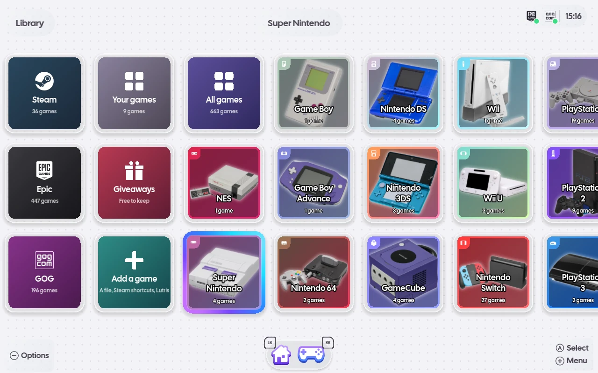
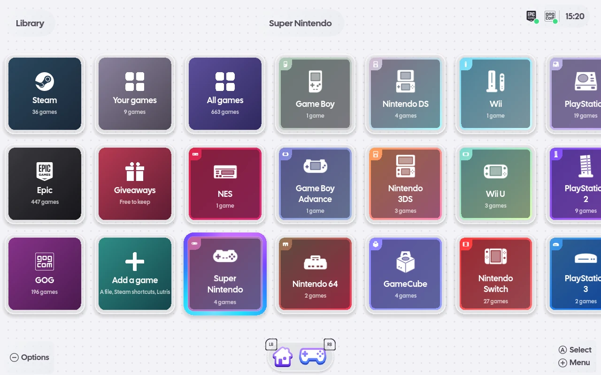
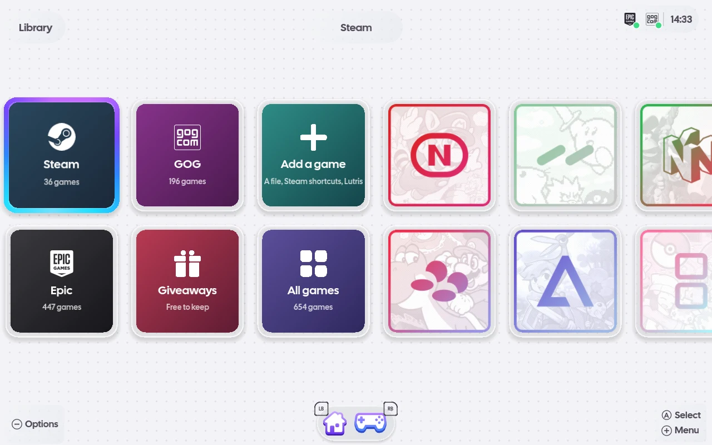

# Console art and sounds

A console's card in Library and the glyph in its tiles' tabs come from a console art theme, chosen
in Settings › Artwork › Console art theme:

- **Photos** (the default): photos of the hardware from Wikimedia Commons, each under the licence
  in its [credits](../../assets/consoles/photos/README.md) (the Wii U card is CC BY-SA 3.0), with
  the Drawings glyphs.
- **Drawings**: openSU's own drawings of the hardware, MIT.
- **iiSU**: iiSU's own art, once you add it (below).

A console a theme has no art for shows a plain tile with its colours, name and game count.

| Photos | Drawings | iiSU |
| --- | --- | --- |
|  |  |  |

## Your own theme

Put a folder with a `theme.json` in `~/.local/share/opensu/themes/<name>/`
(`$XDG_DATA_HOME/opensu/themes/`), laid out as in
[assets/consoles/README.md](../../assets/consoles/README.md).

## iiSU's art and sounds

Download iiSU's APK from its [releases page](https://github.com/iisu-network/iiSU/releases) and put
it in `~/.local/share/opensu/themes/iiSU/`. It then appears in Settings › Artwork › Console art
theme and in Settings › Audio › Interface sounds. (`iiSU_StarterPack.zip` from the same page gives
the art without the sounds.)

openSU does not ship or download iiSU's art or sounds.

## Interface sounds

openSU plays its own UI sounds on the events it shares with iiSU: focus moving, a panel opening and
closing, the context menu, a launch, entering and leaving a console, and switching sections (the
list is in [assets/sounds/README.md](../../assets/sounds/README.md)). They are synthesized by
`tools/sounds/` and MIT like the rest of openSU. Settings › Audio › Interface sounds chooses
openSU's own or iiSU's, once its APK is placed.
