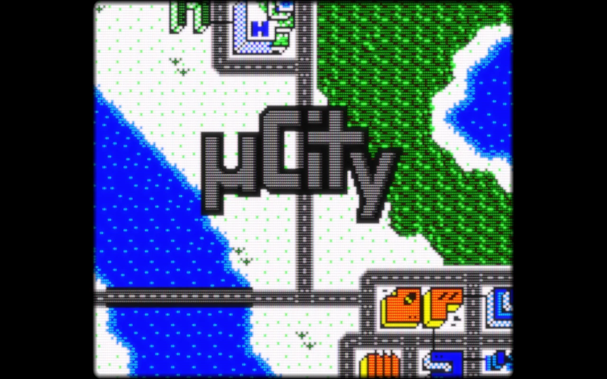
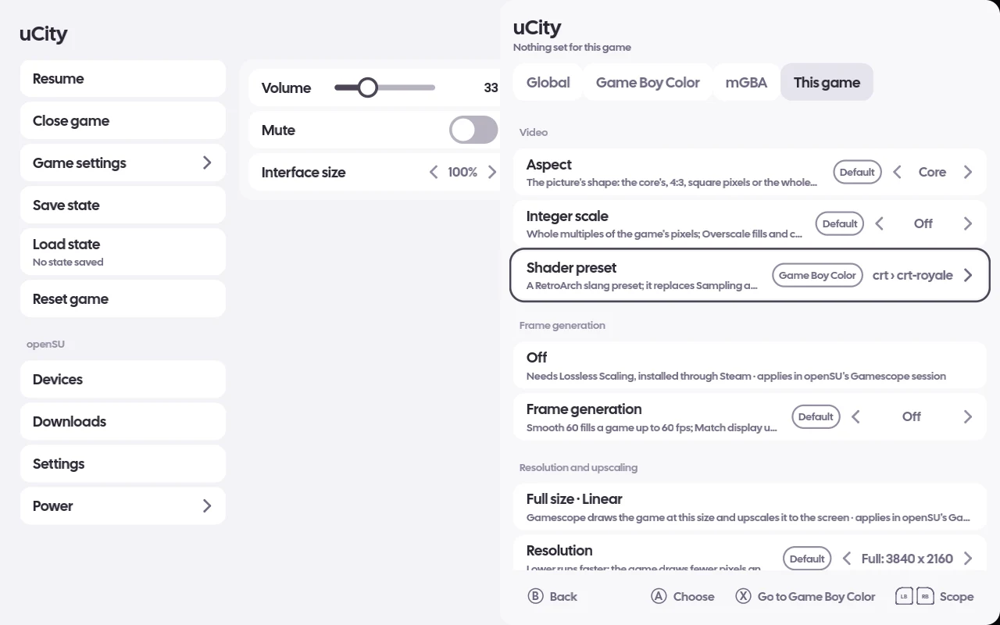
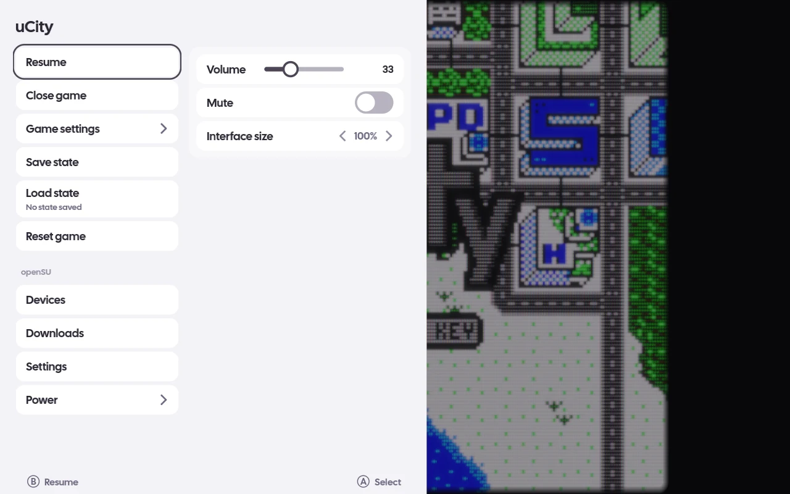

# The built-in libretro runner

`opensu-retro` runs one game in a libretro core, in its own window drawn with Vulkan (MoltenVK on
macOS): the built-in emulator openSU launches like any other. It reads every pad without grabbing
it, the keyboard and, on Android, its own touch controls; plays the core's sound at 48 kHz; and
keeps save RAM in `<data>/opensu/saves/profiles/<profile>/<system>/<rom>.srm`, one folder per
player profile, written when it changes and at exit. Saves from before profiles move into the
first profile's folder once, backed up first under `~/.local/state/opensu/save-backups/before-profiles/`.
It and the ROM library are the two parts of openSU that are always on.

## Cores

The built-in emulators are mGBA (Game Boy, Game Boy Color, Game Boy Advance), Gambatte (Game Boy,
Game Boy Color), Snes9x, Mesen, PCSX ReARMed, Beetle PSX HW and SwanStation (PlayStation),
Mupen64Plus-Next and ParaLLEl N64 (Nintendo 64), PPSSPP (PSP), Flycast (Dreamcast), melonDS DS
(Nintendo DS), Azahar (Nintendo 3DS), Dolphin (GameCube, Wii), PCSX2 (PlayStation 2), and for Arcade FinalBurn Neo, FB Alpha 2012, MAME 2003-Plus, MAME 2010 and MAME
(current). A
console's standalone emulators come first, so turning on standalone emulators does not change what
an installed one runs on. GPU cores (Beetle PSX HW, SwanStation, Mupen64Plus-Next, ParaLLEl N64, Azahar, Dolphin, PCSX2)
draw on the runner's Vulkan device; a core that asks for OpenGL is refused by name.

A core is found in `<data>/opensu/cores/` (openSU's own downloads), then on Linux in
`~/.config/retroarch/cores`, `/usr/lib64/libretro`, `/usr/lib/libretro` and
`/usr/lib/x86_64-linux-gnu/libretro`. A missing core is downloaded from libretro's buildbot from the
game's details page ("Download <core>") or Settings › Emulators › Emulators and cores: every hop
stays on the buildbot's host and the library is checked against the CRC-32 the buildbot lists.
Check for updates compares the listed CRC-32 with the one recorded; nothing updates by itself.

## Arcade romsets

Each arcade core names its romset listing: FinalBurn Neo's arcade and Neo Geo datafiles, FB Alpha
2012's 0.2.97.29 datafile, MAME 2003-Plus's and MAME 2010's `-listxml`, and current MAME's from
mamedev's latest release
(SHA-256 checked). They are downloaded in the background, shown on the Downloads page, kept under
`<cache>/opensu/romsets/` and fetched again after 30 days. Each arcade zip is matched against every
listing, with its parent's, BIOS's and devices' zips in the same folder counted. A FinalBurn listing
names every BIOS a game could use, so one of them is enough there. A BIOS's own zip (`neogeo.zip`)
serves the games beside it and is not listed as a game. The game runs on
the first matching core installed, else the first matching core is offered for download; with none
it is listed but cannot start, and its details page names the nearest core and the files it lacks.
This works in a folder picked on Android too, where a game's parent and BIOS zips are copied beside
it when it starts. FB Alpha 2012 keeps no `.srm`: a game's settings and high scores are in
`<rom>.nv` in the same folder, and it plays older sets without CPS2 `.key` files.

A set made for an older emulator can run on a newer core too. When its files can be turned into what
that core's listing asks for, the details page reads "Matches FinalBurn Neo (built-in) through
conversion" and the first start builds a new zip under `<cache>/opensu/romsets/converted/`. That takes
a moment once; your own zip is never changed, and the cache keeps up to 2 GiB of rebuilt zips, oldest
dropped first. CPS2 games get their `.key` file written for them.

## BIOS

Settings › Emulators › BIOS files lists what each built-in core runs on: the files it looks for,
which of them you have in `<data>/opensu/system/`, and whether it has a built-in HLE BIOS
(PCSX ReARMed's PlayStation BIOS is "HLE built in" until you add a file). PCSX2 needs a
PlayStation 2 BIOS image in `<data>/opensu/system/pcsx2/bios/` (any name; it boots the first one it
finds there, and keeps its NVRAM and memory cards under `<data>/opensu/system/pcsx2/`). openSU ships
and downloads no BIOS, keys or firmware.

## Picture: video settings and shader presets

Every built-in core's game has, under Video:

- **Visual preset**: None, Auto Console or CRT, one choice that sets the shader, filter, aspect and
  a frame drawn around the picture together (below); Aspect, Filter and Shader preset are hidden
  while one applies.
- **Aspect**: Core, 4:3, Pixel 1:1 or Stretch.
- **Integer scale**: Off, On (whole multiples of the game's pixels) or Overscale (fills and crops).
- **Sampling**: Nearest, Bilinear or Sharp bilinear.
- **Filter**: None, Scanlines, LCD grid or CRT (a port of crt-lottes), drawn on the game's own pixel
  grid.
- **Shader preset**: a RetroArch slang preset, which replaces Sampling and Filter.
- **Shader resolution** (shown with a preset): Auto (the default) draws the preset at a lower
  resolution, down to half, only while the GPU cannot finish a frame in time, and at full
  resolution again once it can; a PC that keeps up never changes. Full always draws it at the
  screen's resolution, however slow.

The presets come from libretro's slang shader pack (about 54 MB, each shader under its own
licence): Settings › Emulators › Shader presets downloads it into `<data>/opensu/shaders/slang/`,
checks for a newer build and removes it. The preset picker browses its folders (`crt › crt-royale`,
`pixel-art-scaling › sharp-bilinear-simple`, `bezel › Mega_Bezel` and the rest). The runner builds
presets with librashader, shipped beside it; without it a game with a preset refuses to start and
says why.

### Visual presets

`assets/visual-presets.json` lists them. CRT runs `crt/crt-lottes.slangp` from the shader pack (the
built-in CRT filter while the pack is not downloaded) at 4:3 inside a television on a landscape
screen and inside a curved CRT bezel on a portrait one. Auto Console picks the game's console's own
preset, so far the NES controller frame; a console with none runs as None.

The frames are never shipped. Each image is pinned to a libretro common-overlays commit by URL,
size and SHA-256 and downloads on demand into `<data>/opensu/overlays/<id>.png`: on the first
launch with a preset whose art is missing (the game runs without its frame and a toast says the
frame shows from the next launch), when a preset is chosen over a running game, or from Settings ›
Emulators › Overlay art, which also removes it. The frames are CC BY 4.0; the Visual preset row and
the Overlay art row carry the credit.

The runner letterboxes the frame into the screen above the touch controls, landscape art on a
screen wider than tall and portrait art on a taller one, places the picture inside the art's
picture rect at the preset's aspect and integer scale, and draws the art over it. A picture turned
by Rotate screen has no frame. To check it: `GET /frame.png` from the runner's control port shows
the frame around the game.

## Setting layers

Every per-game setting (video, the core's own options, the emulator pick, frame generation and
resolution) is kept at four layers: Global, the console, the core, and the game. A value resolves
game, then core, then console, then Global, then the default, and every row names the layer it
comes from. One editor shows them all, with a tab per layer: Settings › Emulators (Global, Consoles,
Built-in cores), a game's details page (Game settings) and the Guide menu over a running game (Game
settings, a panel over the game, whose changes reach the game at once).

In the editor, choosing a value sets it at the tab's layer; every list starts with "Use <value>
from <layer>", which removes the tab's own value (Y does the same, and Y again puts it back); X goes
to the tab the value comes from; LB and RB change tabs. Each change is saved at once. The settings
live in `game-settings.json` in openSU's config folder.

A core's own options (Color Correction on mGBA, the renderer on Mupen64Plus-Next, ...) are settings
of the core's and the game's layers, remembered per core so they can be edited while nothing runs.

## Over a running game

The Guide menu over a built-in core's game adds Save and close, Save state, Load state (one slot,
`<saves>/<rom>.state`) and Reset game, the last two asking first, and Game settings opens the
editor above. Close game stops the runner so it writes its save RAM first. A core that crashes is
toasted by name, and a game that fails to load by its reason.

Save and close keeps the game where it is in a resume state of its own
(`<rom>.resume` beside the profile's `.srm`, never your Save state slot; each profile has
its own), writes its save RAM and closes it. It travels with the game's save to paired openSUs and
shared folders, so Play on another machine picks the game up where you left it; a game that keeps
no save of its own resumes only on the machine it was closed on. Starting
the game again puts you back there; the Guide menu then shows "Resumed session" with
the date. The resume
state is used once: it is removed as it loads, on every machine once they next sync, so a game
that crashes later starts from its own save next time. While one is waiting, the game's details page reads "Resumes from <date>" and
offers Start fresh, which throws it away and starts the game from the beginning. A resume state is
not loaded, and the Guide menu says why, when another core wrote it (it is kept for that core),
when the core refuses it, or when the game's save changed since (a copied or synced save is never
undone by it). Close game keeps no resume state.

## Two players

On a GBA game's details page, Play linked (2 players) runs two linked GBAs side by side on mGBA
(built-in), each pad its own player. It needs openSU's own build of mGBA, the one Settings ›
Emulators downloads; an mGBA core from RetroArch or an older buildbot download plays alone until
you update it there. Player 2's save is `<rom>.p2.srm` beside player 1's. Play with
<name> does the same with a paired openSU ([LAN](lan.md)), a cartridge's clock following the emulated
game there rather than your computer's. Game Boy games do not link yet, and single play stays on the
emulator you picked.

## On Android

The runner is a second Activity in a process of its own. Cores come from the buildbot's
`android/latest/<abi>` folder, games in a picked folder are copied into the app's cache before a core
opens them and kept there while the file's size and date hold, up to 4 GiB with the games played
longest ago going first, and the runner draws touch controls that hide when a controller is used and come back at a touch (Touch controls: Dynamic, Always, Never). An arcade game shows its own machine's
panel: an arcade stick, round buttons in the cabinet's number and rows, each named for what it does
in that game when the core says, and small Coin and Start controls, since nothing starts without a
coin. A fighter's punches and kicks show a fist or a foot with L, M or H, punches above kicks. It
sits on the black beside the picture where it fits, reaching over the picture rather than shrinking
below a thumb's size, and hides like the rest when a pad connects. Every other system shows the
usual pad. In portrait the controls stand under the picture instead of beside it. Touch controls size in Game settings makes either 75 to 175% of its size, everywhere or
for a system or a game, and changes a running game at once. MAME 2010 is not offered: its Android
build crashes on load, so a set only it matches reads "No arcade core matches this romset". Back, a
pad's Guide or the pause button
brings the shell's Guide menu in front of the paused game; Resume goes back to it.

Settings › Emulators › Embedded draws the game inside openSU's own window instead, with the core
still in its own process: there is no switch of apps, the card shows the cover and "Starting…" until
the first frame, and a core that crashes leaves the shell up with its toast. It is off by default.

A vertical arcade game starts upright on the landscape screen like everything else, with black beside
it. Rotate screen, the small button beside pause or the row in the Guide, stands the device in portrait
for it, and pressing it again goes back; the screen no longer follows the sensor after that. The choice
is kept for that game, and Rotate screen in Game settings shows it. On a desktop the same button, row or
F9 turns the picture a quarter for a rotated monitor or cabinet.
