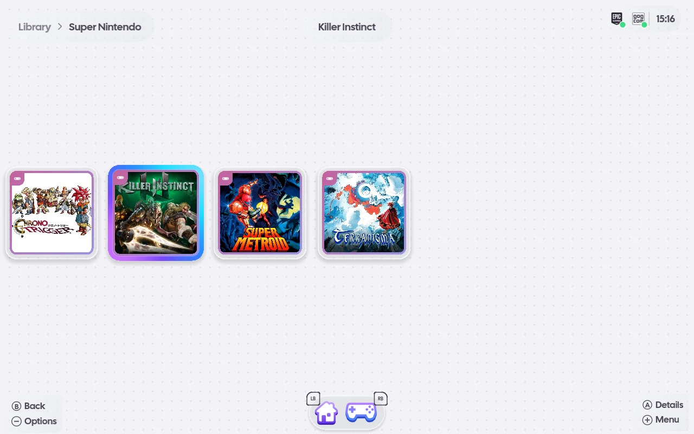

# ROMs and standalone emulators

## ROM folders

ROMs live in a ROM root with one folder per system (`PS2`, `GameCube`, `Switch`, `PSX CHD`, ...).
openSU finds the roots itself: a folder named `ROM`, `ROMs` or `roms` in the home folder, in
`~/Emulation`, or at the top of a mounted drive. Library's Add a ROM folder tile, or Settings ›
Library › Add a ROM folder, adds one (on Android through the system's folder picker), and Find ROM
folders automatically forgets the added ones; either is read at once, without a restart.
`OPENSU_ROM_ROOTS` overrides the search ([environment.md](environment.md)).

A system folder holds game files or game folders; in a folder, the base game is started rather than
its updates and DLC. Library has one tile per console, and each console's shelf its games.

A PS4 dump and a Switch game are titled and shown by their own files: a Switch NSP or XCI is read
with the keys Eden uses (`~/.local/share/eden/keys/prod.keys` and `title.keys`), offline; the keys
are only read, never copied, logged or sent.

## The emulator for each game

Built-in cores ([libretro.md](libretro.md)) are always available. Standalone emulators are an
integration, off until turned on in Settings › Integrations. Then they are found on PATH, as
AppImages in `~/Applications`, `~/AppImages` or `~/.local/bin`, or as Flatpaks: Dolphin, Cemu,
Eden, Ryujinx, Citron, sudachi, PCSX2, RPCS3, shadPS4, DuckStation, PPSSPP, melonDS, Azahar, mGBA, xemu and Xenia
Canary. On Windows and macOS openSU finds and launches the installed ones (macOS in
`/Applications`); on Android it starts an installed emulator app by intent with the game.

A game whose system has no emulator still appears, and pressing play names the emulator to
install. The details page's Emulator row picks one per game, Settings › Emulators per console (both
are setting layers, so a console's pick shows on its games as inherited), and Settings › Library ›
Reset emulator choices forgets every game's own pick. `OPENSU_EMULATORS` overrides the command per
system.

## Copying saves between emulators

When an installed emulator keeps a save of a game and another installed one could take it (Switch
emulators; mGBA and the built-in runner for Game Boy, Game Boy Color and Game Boy Advance;
DuckStation and the built-in runner for PlayStation), the game's details page shows Copy saves,
naming them. It opens a card: Copy from lists the
emulators that hold a save of the game, Copy to every other one, each with its newest change and
size, or "No save yet" (A lists them when there is more than one). Copy saves asks, then replaces
the target's saves of that game with the source's: for Switch the current profile's save and the
device save, for other consoles the game's save file or memory card. A target without one gets it
made where that emulator makes it, for its current profile. The target's saves are backed up first
under `~/.local/state/opensu/save-backups/<console>/<game>/<emulator>/<time>/`, and Undo copy on the same card puts the newest backup back exactly as it
was and removes what the copy made. The row shows how far a copy or an undo is. Nothing is copied
while either emulator is running: close it first, as the message says.

Eden, Citron and sudachi are read from `~/.local/share/<name>/nand` (Eden's newer
`user/save/account` folders too), Ryujinx from `~/.config/Ryujinx/bis`; an emulator installed as a
Flatpak from the same folders under `~/.var/app/<app id>/`. A game is matched by the title id in
its own file, so it needs the Switch keys above. An emulator that has no user profile yet, or a
Ryujinx that has never made its save index, is started once first.

mGBA's saves are read beside the ROM, or from the folder its settings name; its clock is not
carried to the built-in runner, so a game with a clock starts it from the system's time.
DuckStation's per-game memory card (`~/.local/share/duckstation/memcards/<title>_1.mcd`) is copied
whole; a card of another size is refused.

## Emulator downloads

Emulators that publish an official AppImage (Cemu, Eden, PCSX2, RPCS3, DuckStation, PPSSPP, Azahar,
mGBA, xemu) can be downloaded from a ROM's details page ("Download <emulator>") or from Settings ›
Emulators, into `~/.local/share/opensu/emulators/<id>/`. A download is checked against the
release's published SHA-256 and refused on a mismatch; without one, only HTTPS from the project's
own host is accepted and the checksum seen is recorded. Settings › Emulators also checks for
updates (nothing updates by itself) and removes openSU's AppImages. openSU links no BIOS, keys or
firmware. An AppImage needs FUSE (`/dev/fuse`, `fusermount`); one built on the older runtime also
needs libfuse2, and openSU names the package to install when it is missing.

Every download, with its progress, is on the Downloads page ([stores.md](stores.md#downloads)).
