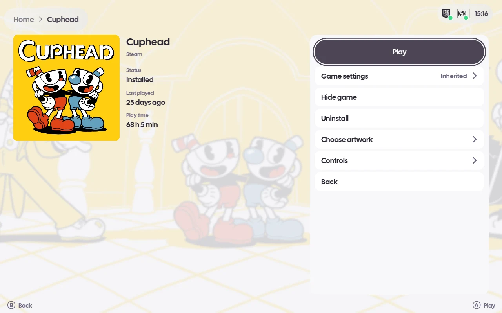

# Stores, Steam and your own games

openSU ships no games and does no store's work itself where the store has a client: Steam and
Legendary keep doing their own authentication, downloading and cloud sync, and openSU reads what
they have installed and hands launches back to them. GOG is signed in by openSU itself, and `gogdl`
downloads its games.

## Integrations

Only the ROM library and the built-in libretro runner are on by default. Steam, Epic, GOG,
standalone emulators, Lua plugins and LAN ([lan.md](lan.md)) are each turned on in Settings ›
Integrations; one that is off starts nothing, reads nothing and shows nothing (no client, no
`legendary`, no tiles, no Settings pages). A fresh start goes straight to Home with all of them
off. While one is off, Library has a Set up tile for it (Set up Steam, Set up Epic, ...) that opens its switch in Settings ›
Integrations; the tile goes once the integration is on. On Android only standalone emulators, Lua
plugins and LAN are offered.

## Steam modes

| Mode | Where | What openSU does with Steam |
| --- | --- | --- |
| Off | everywhere | Nothing; no Steam games listed. |
| Normal | Linux, Windows, macOS | Uses your own desktop Steam: attaches to the one running, or starts it on the desktop and leaves it running, and launches through it (`steam -applaunch`, `steam://` elsewhere). It never holds the pad against Steam or closes its windows. |
| Managed | Linux | Runs openSU's own Steam in the background inside openSU's Gamescope with `-cef-enable-debugging`, which opens Steam's DevTools on 127.0.0.1:8080; that is how it reads download progress and starts installs through Steam's own installer. openSU holds the pad so Steam never sees Guide, closes Big Picture, and ends Steam on exit. |
| Isolated | Linux | Managed, with Steam in a bubblewrap sandbox that sees your real home and login but only openSU's four virtual pads (or, by choice, every controller), and a session bus that offers only the Secret Service. |

Under `--session` (openSU as the login session) only Managed and Isolated are offered. A desktop
Steam serves its DevTools only when started with `-cef-enable-debugging`, so Normal mode's installs
and download progress need that flag. Steam's Big Picture does not open inside openSU's session:
Guide in the shell never reaches Steam, and Big Picture opened any other way is closed and the
shell put back in front.

Settings › Steam libraries lists Steam's libraries with free space and games, adds one, sets the
default and removes an empty one; it is read-only while Steam is not running. Settings › Install
folders shows the folder each store installs into and whether it is the store's own, the default
or an override.

## Signing in to GOG and Epic

Sign-in happens in your own browser, on the store's own page. openSU opens the page with
`xdg-open`, and a small browser extension hands the code the page ends on to openSU's control
channel and closes the tab. The build packs it as `~/.local/share/opensu/opensu-signin.xpi` (for
the `$HOME/.local` prefix); a release carries it beside the AppImage.

Zen does not require signed extensions, so it can be installed for good: close Zen, copy the `.xpi`
to `<profile>/extensions/opensu-signin@opensu.xpi` (the Flatpak's profiles are under
`~/.var/app/app.zen_browser.zen/.zen/`), and add to the profile's `user.js`:

```js
user_pref("xpinstall.signatures.required", false);
user_pref("extensions.autoDisableScopes", 14);  // enable add-ons placed in this profile
```

Firefox release builds enforce signing, so there it can only be loaded per session:
`about:debugging` › This Firefox › Load Temporary Add-on › the `.xpi` (Ctrl+L takes a typed path).
A Flatpak browser cannot load the bare `manifest.json`: its file picker hands over only the chosen
file, not the scripts beside it. The extension talks to port 7311, openSU's default
`OPENSU_CONTROL_PORT`.

```sh
curl -X POST http://127.0.0.1:7311/signin/gog/start   # opens GOG's sign-in page
curl -X POST http://127.0.0.1:7311/signin/epic/start  # opens Epic's, through Legendary's login
```

`POST /signin/gog` and `POST /signin/epic` take the authorization code as the body; the extension
does that for you. Epic's code is given to `legendary auth --code`. GOG's token is kept in
`$XDG_DATA_HOME/opensu/gog-token.json` (default `~/.local/share/opensu`), readable by you only.

## Installing GOG games

GOG downloads go through `gogdl`, Heroic's standalone GOG downloader (no Heroic launcher). Install
it once, without root, pinned to the revision openSU was written against:

```sh
uv tool install "git+https://github.com/Heroic-Games-Launcher/heroic-gogdl@ac1580aeb004dda75557c97be9cc3105d50eeecb"
```

It needs a C compiler, for its xdelta3 extension. On Linux a game with a Linux build is downloaded
as that build; otherwise the Windows build is downloaded and run under Wine ([wine.md](wine.md)).
Games land in `$XDG_DATA_HOME/opensu/gog-games/<id>/`.

## Downloads

Guide › Downloads lists every download openSU knows of: Steam's queue (its updates too), the Epic,
GOG or Steam install started from openSU, an emulator, core, shader pack or romset listing
download, and the Wine runners openSU keeps, each with its progress and state. Steam's downloads
can be paused and resumed (the whole queue, as in Steam), started now, moved and removed; the
others can be cancelled. Finished downloads stay listed until openSU quits. A click on the Steam
badge in the top bar while it shows a download's progress ring opens it too.

## Updating games

When the library loads, openSU checks which installed Steam, Epic and GOG games have an update: a
small arrow on the tile marks them, and their details page and tile menu offer Update. Nothing
updates by itself, and launching a game with an update starts the installed version. Epic games
update through `legendary update`, GOG games through `gogdl update` in the folder they were
installed to, and a Steam game's update is put on Steam's own queue. An update is refused while the
game runs or another install, update or uninstall is under way, and shows on the Downloads page.

## Epic cloud saves

An installed Epic game whose saves Epic keeps in its cloud syncs them through Legendary: before it
starts the newer cloud save is taken, after it ends a changed save is given, and the details page's
**Saves** says how they stand with Epic (In sync, Newer on Epic, Newer here, Conflict). A save
changed both here and in Epic's cloud since they last synced is never overwritten: **Pick which save
to keep** offers both with their dates, and the save replaced here is copied first into openSU's
state folder under `save-backups/epic/<app>/<UTC time>/`. The first time, a game whose save folder
Legendary has not set yet gets the one Legendary works out. GOG cloud saves are not synced yet.

## Uninstalling games

An installed Steam, Epic or GOG game's details page and tile menu (Select) have Uninstall. The
first press says what will go, and a second press removes it; moving to another button cancels.
Steam removes its own games through its own uninstaller; Epic games go through
`legendary uninstall`. A GOG game's folder is deleted only when it is inside the folder openSU gave
`gogdl` for it (`<install folder>/<id>/`); a game recorded anywhere else is only forgotten, its
files kept. Wine prefixes and ROMs are never deleted. An uninstall is refused while the game runs
or another install or uninstall is under way, and shows on the Downloads page while it runs.

## Your own games

Library's Add a game tile picks a Linux program, script or AppImage, a Windows `.exe`, or a shortcut
(`.lnk`, `.url`, `.desktop`), and identifies it (title, platform, Steam app and cover) for you to
confirm. Steam's non-Steam shortcuts and Lutris's games are imported read-only. An added game's menu
has Rename, Change file and Remove from library. Android has no Add a game.

Add a game folder, the tile beside it and in Settings › Library, keeps a folder in step with the
library: it is read each time the library loads, so a new file adds a game and a deleted one removes
it. On Windows it takes the `.lnk` and `.url` shortcuts in the folder and one `.exe` from each
immediate subfolder; on Linux its `.desktop` entries and programs, and one program, Windows `.exe`s
included, from each immediate subfolder; on macOS its `.app` bundles and those one folder down. A
game is named by its shortcut, else by its folder or the program's version info. Hide game works on
these; Rename, Change file and Remove do not, as the file is what keeps the game there.

What is left out: installers and uninstallers, redistributables, DirectX and .NET setups, updaters
and patchers, crash reporters, anti-cheat, and store clients that only start other games. The rule
is `library::folder::notAGame`: a whole word of the name (so `Crash Bandicoot` stays and
`UnityCrashHandler64` goes), a tool's name anywhere in it, or a store client's exact name.

## Artwork and SteamGridDB

Covers come from Steam's CDN, the stores, gamesdb and the libretro thumbnails. With a SteamGridDB
key, a cover Home's square tiles would crop or letterbox is replaced by SteamGridDB's square one
(the original stays on disk), and a game's details page offers Choose artwork, a picker of
SteamGridDB's covers kept per game.



Settings › Artwork › Connect SteamGridDB gets the key through the Steam login: in Managed and
Isolated modes openSU opens SteamGridDB's Steam sign-in in Steam's own browser (Big Picture),
makes the API key if there is none and reads it; you only confirm Steam's Sign In page. In Normal
mode that needs the desktop Steam's DevTools (`-cef-enable-debugging`); otherwise, and with no
Steam, openSU opens your browser and Enter a key takes the key with the on-screen keyboard. The key
is kept in the desktop keyring (or a file only you can read, with `OPENSU_SECRET_STORE=file`), never
logged or shown in full; Disconnect forgets it.

## Giveaways

Library's Giveaways tile lists the free-to-keep offers from Epic, GOG and Steam, read in the
background, with art, store, when each ends and whether you own it already. Claim opens the
store's page (Steam's in Big Picture when openSU's Steam runs).
