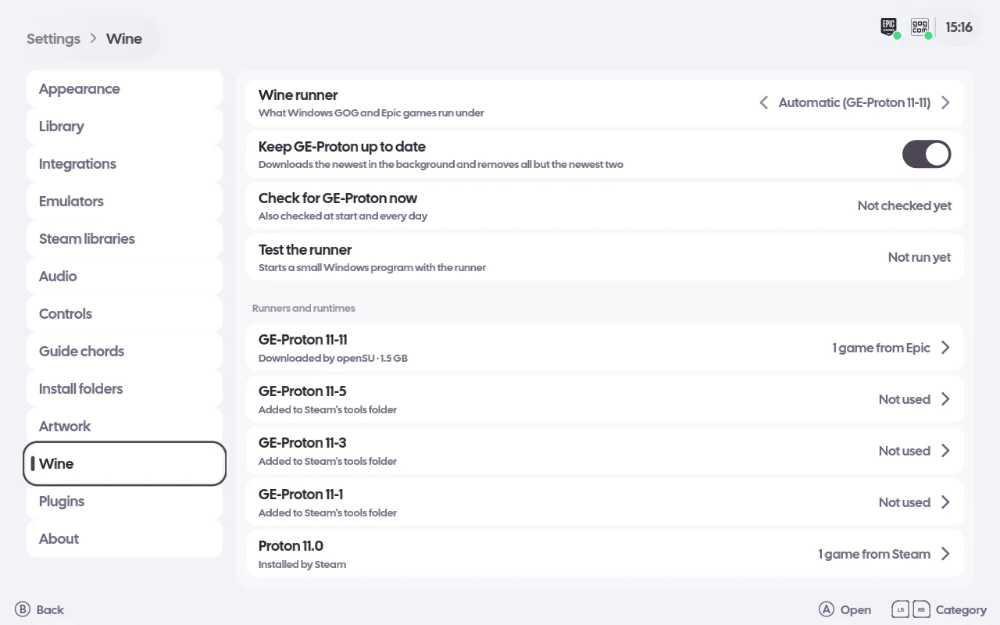

# Windows games, Wine and Proton

On Linux, the Windows builds of GOG and Epic games (and Windows `.exe` files added with Add a game)
run under a Wine runner openSU picks. Steam games keep the compatibility tool chosen in Steam. On
Windows openSU runs a store's Windows builds itself; on macOS Wine is not offered and a store's Mac
builds are installed instead.

## The runner

Settings › Wine › Wine runner is Automatic by default: the first that can run of openSU's own
newest GE-Proton, Steam's newest Proton, what Lutris uses, and the system `wine`. The row shows what
Automatic comes to now and why. It can be set to any runner found instead, and a game can be pinned
to one of its own. A launch never waits for a download.

GE-Proton and umu-launcher are openSU's own, under `<data>/opensu/wine/`: downloaded in the
background while GOG or Epic is signed in, checked at start, every day and on Check for GE-Proton
now, verified against their published SHA-512 and SHA-256, and shown on the Downloads page. Keep
GE-Proton up to date removes all but the newest two builds, unless a running game, the runner pick
or a pinned game keeps one. Test the runner starts a small Windows program with it.

A Proton build runs through umu-launcher, with the game's protonfixes picked from the umu database
by its GOG product id or Epic app name (a local copy is fetched with the GE-Proton check). Plain
Wine runs the game directly.

Runners and runtimes lists every runner and runtime with where it came from, its size and how many
games use it (a Steam game counted by Steam's own choice), each with a page of its games and pins.

## Prefixes

Every such game shares one prefix, `$XDG_DATA_HOME/opensu/wine-prefix`. A game's details page has
Wine prefix: switch it to Own and that game gets
`$XDG_DATA_HOME/opensu/wine-prefixes/<store>-<id>` instead. Plain Wine never runs in a prefix
Proton made (Proton links its own DLLs into it); it gets the same path with `.plain-wine` added.
Uninstalling a game never deletes a prefix.
